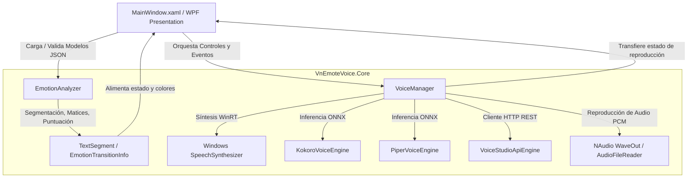

# Vn Emote Voice (TTS) 🎙️🎭

**Sistema de Síntesis de Voz (TTS) y Análisis Emocional para Narradores Virtuales y Avatares VTuber**

[](LICENSE)
[-512BD4.svg)](https://dotnet.microsoft.com/)
[](https://learn.microsoft.com/en-us/dotnet/desktop/wpf/)
[](https://onnxruntime.ai/)

---

## 📌 1. Descripción y Propósito del Proyecto

**Vn Emote Voice** es una aplicación y biblioteca modular desarrollada en **C# / .NET 10 (WPF)** concebida como el **motor de voz y gesticulación emocional** para la creación de **narradores virtuales, novelas visuales interactivas y avatares VTuber** (Live2D, VRoid, modelos 3D en Unity o Unreal Engine).

A diferencia de un sintetizador de voz tradicional que solo convierte texto plano en audio de forma plana y monótona, **Vn Emote Voice**:
1. **Analiza el discurso oración por oración**, detectando la carga psicológica del texto mediante un motor léxico-contextual con 27 categorías emocionales.
2. **Interpreta los signos ortográficos** (`!`, `?`, `...`, MAYÚSCULAS) para modular el grado de intensidad (entonación *Exaltada*, *Gritando*, *Preguntando*, *Agitada*, *Quebrada*, etc.).
3. **Identifica transiciones y giros dramáticos** dentro de un mismo segmento (ejemplo: `Duda/Preguntando ➔ Furia/Gritando`).
4. **Sintetiza audio de alta fidelidad** conectándose a múltiples motores locales y remotos (Windows Speech, Kokoro v1.0, Piper ONNX y VoiceStudio API).
5. **Exporta paquetes de voz y metadatos JSON**, proporcionando a los sistemas de animación o avatares la información exacta para sincronizar expresiones faciales, cambios de pose y movimientos de cámara en tiempo real.

---

## ✨ 2. Características Principales

### 🧠 Análisis Emocional Contextual y Soporte Multilenguaje
- **27 categorías emocionales calibradas:** *Furia, Intriga, Miedo, Terror, Pánico, Burla, Lujuria, Ego, SobreConfianza, Soberbia, Confianza, Armonía, Exigencia, Duda, Cansancio, Plenitud, Irritación, Tristeza, Alegría, Sorpresa, Decepción, Esperanza, Ternura, Envidia, Vergüenza, Culpa y Gratitud*.
- **Modificadores de entonación por signos:** Calificación de emociones según la puntuación ortográfica.
- **Detección de puntos de pivote y transición:** Rastreo de conectores de contraste (`pero`, `sin embargo`, `de pronto`, etc.) para detectar saltos emocionales internos en oraciones compuestas.
- **Reglas de negación:** Anulación de falsos positivos léxicos (ej. *"no tengo miedo"* anula *Miedo* y promueve *Confianza*).
- **Modelos de lenguaje en JSON externos desacoplados:**
  - `emotions_es-mx.json`: Modelo calibrado para Español de México (cargado por defecto).
  - `emotions_es-es.json`: Modelo calibrado para Español de España (Castellano).
  - `emotions_en-gb.json`: Modelo calibrado para Inglés Británico.
  - Soporte para importar y validar en tiempo de ejecución cualquier archivo JSON con nuevos idiomas o personalizaciones.

### 🔊 Arquitectura Multi-Motor TTS
- **Voces del Sistema Windows (WinRT / SAPI):** Acceso nativo a todas las voces locales y voces Online Natural instaladas en Windows 10/11 con soporte para SSML.
- **Kokoro v1.0 (ONNX Local):** Motor neuronal de vanguardia con audio cristalino a 24 kHz y catálogo multiidioma (Inglés, Español, Francés, Japonés, Chino, etc.).
- **Piper TTS (ONNX Local):** Carga dinámica de modelos neuronales ultrarrápidos y compactos mediante pares de archivos `.onnx` y `.json`.
- **VoiceStudio API (OmniVoice Remoto / Localhost):** Cliente de integración con servidores de difusión acústica VoiceStudio, permitiendo control total de refinamiento acústico (`guidance_scale`, pasos de difusión `num_step`, `t_shift`, temperaturas de sonido, etc.).

### 🎛️ Experiencia de Usuario y Reproducción Reactiva
- **Editor enriquecido sincronizado:** El texto leído se resalta dinámicamente en tiempo real con scroll automático inteligente para que el segmento activo nunca salga de la vista.
- **Ajustes acústicos en caliente:** Modificación de Velocidad (Rate), Tono (Pitch) y Volumen durante la reproducción con adaptación suave sin necesidad de reiniciar el audio.
- **Interacción directa con el texto:** Clic en cualquier segmento del texto para saltar la reproducción y actuar el avatar de forma instantánea.

### 📦 Exportación Estructurada para Animación
- **Exportación de audio maestro (`.wav`):** Genera la pista continua completa.
- **Exportación segmentada con manifiesto JSON:** Guarda cada segmento de audio en un archivo `.wav` independiente y genera un archivo descriptivo `segments_info.json` con los timestamps, emoción dominante, modificador, transición y emojis para alimentar motores de animación (VTuber / Unity / Blender / Unreal).

---

## 🏛️ 3. Arquitectura del Software

El proyecto sigue una arquitectura desacoplada basada en la separación estricta de responsabilidades entre el motor central (**VnEmoteVoice.Core**) y la interfaz de usuario (**VnEmoteVoice.Console**):



### Componentes Principales:
- **`EmotionAnalyzer`:** Clase estática autogestionada responsable del análisis de PLN. Carga configuraciones JSON, aplica reglas de normalización léxica, detección de pivotes y ponderación de emociones.
- **`VoiceManager`:** Fachada única para la síntesis y control de hardware de audio. Desacoplado de la lógica lingüística, se enfoca exclusivamente en la conmutación entre motores y en la reproducción vía `NAudio`.
- **`KokoroVoiceEngine`:** Motor de inferencia ONNX para el modelo Kokoro v1.0, tokenización G2P con `MisakiSharp` y eSpeak, y ensamblado de tensores de estilo a 24 kHz.
- **`PiperVoiceEngine`:** Motor de inferencia ONNX para voces Piper, con resolución fonética y segmentación de silencios acústicos.
- **`VoiceStudioApiEngine`:** Cliente HTTP para la API de difusión de VoiceStudio, parametrizando presets acústicos (`broadcast`/crudo) y resolviendo perfiles de voz.
- **`MainWindow` (WPF):** Interfaz gráfica reactiva en modo oscuro que enlaza los eventos de audio, resaltado en `RichTextBox`, selección de modelo emocional y exportación de archivos.

---

## ⚖️ 4. Evaluación de la Licencia y Compatibilidad Legal

El proyecto está licenciado bajo la **Licencia MIT** ([LICENSE](LICENSE)).

### ¿Es admisible la licencia MIT para este proyecto?
**Sí, es 100% admisible, válida y compatible.** 

A continuación se detalla la compatibilidad con las dependencias y tecnologías que integra:

| Componente / Dependencia | Licencia del Tercero | Compatibilidad con MIT | Justificación |
|---|---|---|---|
| **VnEmoteVoice (Código propio)** | **MIT License** | ✅ Nativa | Permisiva, permite uso comercial, modificación y distribución privada o pública. |
| **Microsoft.ML.OnnxRuntime** | MIT License | ✅ Total | Licencia idéntica y compatible. |
| **NAudio** | MIT License | ✅ Total | Licencia idéntica y compatible. |
| **MisakiSharp** | MIT / Apache 2.0 | ✅ Total | Ambas licencias son permisivas y compatibles con código host bajo MIT. |
| **Windows WinRT Speech API** | Propietaria de Microsoft OS | ✅ Total | Se invoca a través de las APIs oficiales del SDK de Windows sin redistribuir binarios protegidos. |
| **Kokoro TTS (v1.0 Weights)** | Apache 2.0 | ✅ Compatible | Apache 2.0 permite el uso en proyectos MIT siempre que se respete la atribución y aviso original en caso de redistribuir los pesos. |
| **Piper TTS (Rhasspy)** | MIT License | ✅ Total | El código del motor Piper es MIT. Los modelos de voz externos poseen licencias permisivas (MIT, CC0, CC-BY). |
| **VoiceStudio (OmniVoice)** | Cliente de API independiente | ✅ Total | Se consume como servicio HTTP externo; no hay contaminación de licencias. |

> 📌 **Nota sobre modelos ONNX:** Los pesos de los modelos neuronales (`kokoro-v1.0.onnx`, `voices-v1.0.bin` o modelos `.onnx` de Piper) conservan sus respectivas licencias originales emitidas por sus creadores.

---

## 📋 5. Requisitos del Sistema

- **Sistema Operativo:** Windows 10 (versión 2004 / compilación 19041 o superior) o Windows 11 (64 bits).
- **Entorno de Ejecución:** [.NET 10.0 SDK](https://dotnet.microsoft.com/) instalado en el sistema.
- **Hardware Recomendado:**
  - CPU de 4 núcleos o superior (x64).
  - 8 GB de memoria RAM (mínimo 4 GB).
  - Tarjeta de sonido estándar compatible con controladores WASAPI / DirectSound.
  - Conexión a Internet únicamente si se utilizan voces Online Natural de Windows o servicios externos.

---

## 🚀 6. Compilación y Ejecución

### 1. Clonar el repositorio
```powershell
git clone https://github.com/tu-usuario/Desktop_Voice_Win-UnU_TTS.git
cd Desktop_Voice_Win-UnU_TTS
```

### 2. Restaurar dependencias y compilar
Para compilar la solución en modo Debug o Release:
```powershell
dotnet restore
dotnet build --configuration Release
```

### 3. Ejecutar la aplicación
```powershell
dotnet run --project VnEmoteVoice.Console/VnEmoteVoice.Console.csproj
```
o ejecutando directamente el binario generado:
```powershell
.\VnEmoteVoice.Console\bin\Release\net10.0-windows10.0.19041.0\VnEmoteVoice.Console.exe
```

---

## 📖 7. Guía de Uso

### 1. Selección de Voz y Motor
- En el panel izquierdo, despliega la lista **Voz** para elegir entre:
  - Voces integradas de Windows (`Local` u `Online`).
  - Modelos locales de **Kokoro** (si los pesos están en `__Models/`).
  - **Pipper (Externo):** Pulsa el botón de carga para asociar un par de archivos `.onnx` y `.json`.
  - **VoiceStudio Api (Externo):** Introduce la URL de tu instancia (por defecto `http://localhost:3902`), pulsa *Conectar*, selecciona el perfil deseado y ajusta los parámetros de difusión acústica.

### 2. Selección del Modelo Emocional
Bajo la sección **🧠 Análisis de Emociones**:
- **Usar modelo en Español (por defecto):** Mantiene activo `emotions_es-mx.json`.
- **Cargar archivo personalizado:** Desmarca la casilla para habilitar el selector de archivos y carga cualquier archivo JSON de emociones (por ejemplo, `__Assets/emotions_es-es.json` o `__Assets/emotions_en-gb.json`). El sistema validará su estructura y número de emociones de forma inmediata.

### 3. Reproducción y Ajustes en Tiempo Real
- Pulsa **▶ Reproducir** para sintetizar y escuchar el texto.
- Los deslizadores de **Velocidad**, **Tono** y **Volumen** aplicarán cambios inmediatamente a la reproducción en curso.
- Puedes pausar con **⏸** o detener con **⏹**.

### 4. Exportación para Animación
- **Descargar Audio Completo:** Genera un archivo `.wav` único con la narración de todo el texto.
- **Descargar por Segmentos (WAVs + JSON):** Solicita una carpeta de destino y genera:
  - `segment_001_Emocion.wav`, `segment_002_Emocion.wav`, etc.
  - `segments_info.json`: Lista detallada de cada fragmento con su texto, emoción dominante calificada, emoji, desglose de sub-emociones y metadatos de transición emocional para sincronizar tu avatar.

---

## ⚠️ 8. Limitaciones de Uso y Consideraciones Técnicas

1. **Exclusividad de Sistema Operativo:** Debido al uso de la biblioteca WPF y las APIs de síntesis WinRT de Windows (`Windows.Media.SpeechSynthesis`), la aplicación solo es compatible con entornos Windows.
2. **Políticas de Seguridad de Windows (Smart App Control):** En sistemas Windows 11 con *Smart App Control* (SAC) configurado en modo estricto, la ejecución de binarios compilados localmente desde terminales de sandbox o entornos no firmados digitalmente puede requerir desbloqueo de archivos (`Unblock-File`) o exclusión de la política en Seguridad de Windows.
3. **Control de Tono (Pitch) en Redes Neuronales:** Ciertos motores TTS basados en redes neuronales profundas (como Kokoro o Piper) sintetizan el tono de forma intrínseca a través del modelo acústico, por lo que el slider de tono tiene efecto principal en las voces sintetizadas mediante el motor WinRT de Windows.
4. **Almacenamiento de Modelos Neuronales:** Los archivos de pesos neuronales de gran tamaño (`kokoro-v1.0.onnx`, ~300 MB) no están incluidos en el repositorio git por razones de peso. Deben situarse en la carpeta `__Models/` para habilitar el motor Kokoro.

---

## 📄 9. Licencia y Créditos

Este proyecto se distribuye bajo la **Licencia MIT**. Consulta el archivo [LICENSE](LICENSE) para más detalles.

### Créditos y Agradecimientos a Proyectos de Terceros:
- **Kokoro-82M:** Modelo TTS desarrollado por [hexgrad](https://huggingface.co/hexgrad/Kokoro-82M) (Licencia Apache 2.0).
- **Piper TTS:** Sistema neuronal rápido desarrollado por [Rhasspy](https://github.com/rhasspy/piper) (Licencia MIT).
- **NAudio:** Biblioteca de procesamiento de audio en .NET creada por Mark Heath (Licencia MIT).
- **Microsoft ONNX Runtime:** Motor de inferencia multiplataforma de Microsoft (Licencia MIT).
- **MisakiSharp:** Motor de conversión G2P y tokenización fonética para C# (Licencia MIT).
